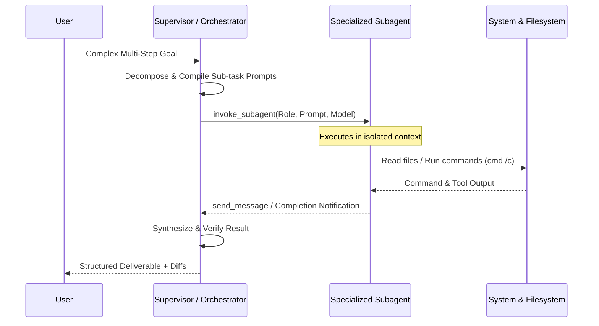

# Multi-Agent Orchestration Patterns & SOTA Topologies

## 1. Topologies Overview

### Pattern A: Router-Dispatcher (Fast 1:1 Routing)
* **When to use**: User queries are diverse but isolated; each query belongs to a single specialized domain (e.g. documentation, bugfix, DB query).
* **Mechanism**: Central router parses intent, selects exactly one expert subagent or toolchain, dispatches prompt, and returns the result directly.
* **Overhead**: Minimum token consumption, lowest latency.

### Pattern B: Supervisor-Worker (Hierarchical Decomposition)
* **When to use**: Complex workflows requiring parallel task execution or sequential dependency chains (e.g. full-stack feature development).
* **Mechanism**: Supervisor breaks user prompt into discrete sub-tasks, assigns each to specialized worker subagents (`research`, `builder`, `tester`), manages progress state, and aggregates final deliverables.
* **Overhead**: Moderate token consumption, high precision and quality.

### Pattern C: Generator-Critic (Dual-Agent Review Loop)
* **When to use**: Security audits, mission-critical infrastructure code, refactoring high-traffic algorithms.
* **Mechanism**: Agent 1 (Generator) produces implementation -> Agent 2 (Critic / Reviewer) evaluates against checklist (OWASP, test coverage, style) -> Iterative refinement until passing score or threshold.
* **Overhead**: Higher token consumption, zero hallucination tolerance.

---

## 2. State & Memory Management

Agents maintain three tiers of operational memory:
1. **Working Memory (Scratchpad)**: In-context variables, current tool results, and immediate step reflections. Flushed between major phases.
2. **Episodic Memory (Transcripts)**: Session-scoped conversation logs located at `.system_generated/logs/transcript.jsonl`. Accessible for auditing prior decisions.
3. **Semantic Memory (Index & Rules)**: Persistent project context encoded in `.agents/agent-index.md`, `GEMINI.md`, and dedicated skill references.

---

## 3. Delegation & Subagent Lifecycle Protocol

### Lifecycle Rules:
- **No Idle Polling**: The supervisor must never poll running subagents in a loop. Await reactive wakeup events from the runtime messaging bus.
- **Resource Cleanup**: Terminate subagents (`manage_subagents` with `kill` or `kill_all`) when execution batches are finished or aborted.
- **Context Preservation**: Avoid piping entire raw file dumps between subagents; summarize key findings and provide file paths with line references.
