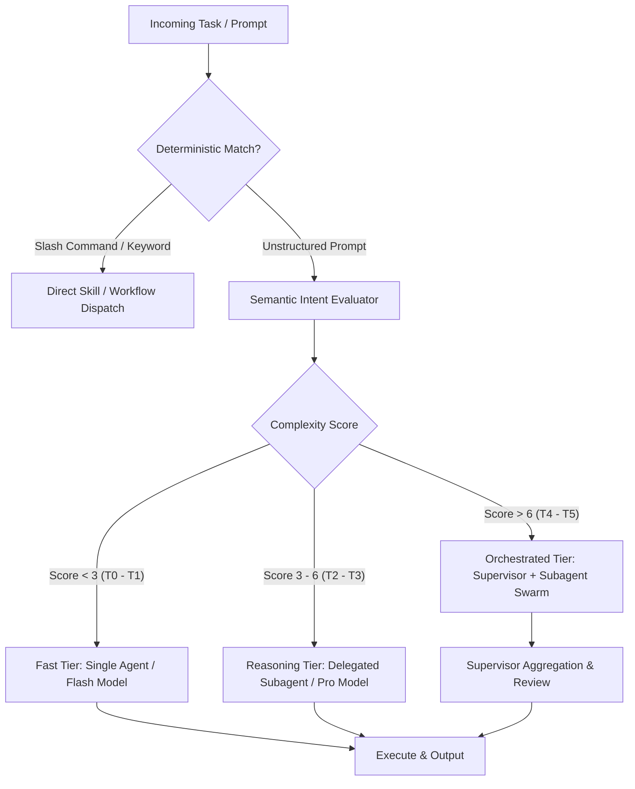

# Semantic Routing & Model Dispatch Matrix

## 1. Intent Classification Taxonomy

Every incoming prompt or task is classified into one of six cognitive intent classes:

| Class | Characteristics | Examples | Recommended Topology | Recommended Model Tier |
| :--- | :--- | :--- | :--- | :--- |
| **T0: Trivial / Direct** | Static lookup, formatting, simple file read, status check | "Show git status", "Format this JSON" | Single-turn, direct tool | `flash_lite` / `flash` |
| **T1: Targeted Edit** | 1-2 file edits, local bugfix, adding unit test | "Fix null check in auth.ts", "Add export" | Single agent (e.g. `cavecrew-builder`) | `flash` |
| **T2: Deep Research** | Codebase exploration, API discovery, web search | "Find all IPC handlers", "Search API docs" | Isolated subagent (`research`) | `flash` / `pro` |
| **T3: Architectural Plan**| Multi-file feature design, schema migration, system RFC | "Design WebSocket state sync", "Plan Auth" | Multi-stage (`plan-feature` + `self`) | `pro` |
| **T4: Multi-Agent Build** | Complex feature refactor across multiple layers | "Refactor UI, state store, and IPC bridge" | Supervisor-Worker (`cavecrew` + subagents)| `pro` (Supervisor) + `flash` (Workers) |
| **T5: Critical Audit** | Security review, OWASP scan, performance audit | "Audit IPC handlers for security vulnerabilities"| Generator-Critic (`security_audit` / `code_review`)| `pro` |

---

## 2. Router Decision Pipeline

---

## 3. Router Cost & Latency Optimization Rules

1. **Lightweight First**: Never route a read-only search or single-file fix to a heavy reasoning model if a fast model with targeted instructions can accomplish it with lower latency and token usage.
2. **Context Window Isolation**: Subagents investigating huge codebases must run in separate conversation context (`Workspace: inherit` or `branch`) to prevent saturating the main agent's working memory.
3. **Progressive Disclosure**: When recommending skills or agents, only present metadata and concise triggers. Do not load full skill instructions until an agent or user invokes that capability.
4. **Deterministic Fallbacks**: If routing confidence falls below 0.65, fall back to asking a clarifying question (`ask_question`) or default to an exploratory planner with `pro`.
