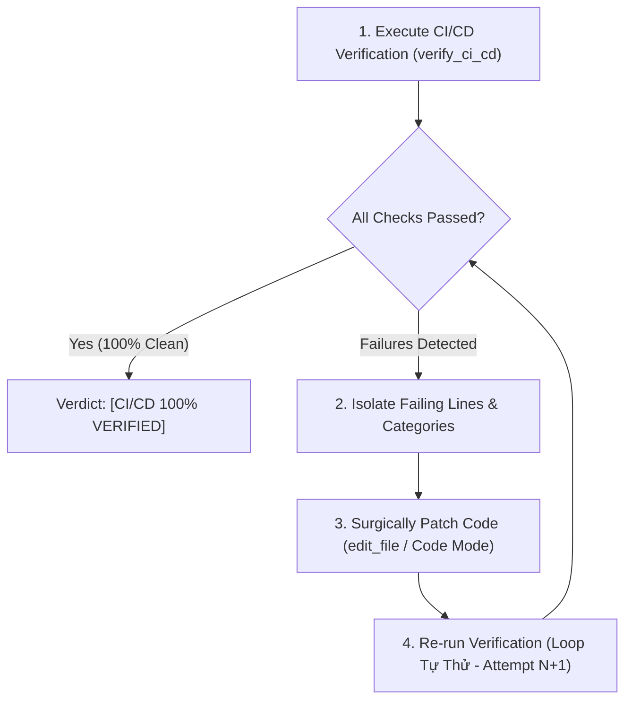

# Autonomous CI/CD & Lint Self-Healing Skill

Use this built-in skill when an agent or developer needs to diagnose CI/CD failures, fix lint and compiler errors, inspect GitHub Actions workflows, or execute an autonomous iterative self-repair loop (`loop agent tự thử`).

---

## 🎯 Trigger Scenarios & Intent Detection
- Prompts: "test ci", "kiểm tra ci/cd", "fix lint errors", "sửa lỗi ci kết hợp lint", "run ci loop", "tự thử lỗi ci", "audit workflows".
- Prior to pushing to GitHub or creating pull requests to ensure 100% CI green status.
- When working within the **CI/CD & Lint Self-Healing Ensemble** (`combo-ci-cd-loop-healer`).

---

## 🚀 Protocol 1: GitHub Remote & Workflow Configuration Audit
1. **GitHub Remote Connection:**
   - Detect remote origin (`git remote get-url origin`) to verify repository linkage.
   - If `githubToken` is connected in Studio, audit authentication permissions.
2. **Workflow File Syntax Gate:**
   - Inspect `.github/workflows/*.yml` / `.yaml` for structural validity.
   - Ensure explicit `jobs:` declarations, checkout actions (`actions/checkout@v4`), setup toolchains, and environment secrets (`GH_TOKEN` / `GITHUB_TOKEN`).

---

## 🔍 Protocol 2: Multi-Tier Verification & Composite Error Aggregation
Call `verify_ci_cd` to execute the composite verification suite across 5 integrated tiers:
1. **Tier 1 (Lint Gate):** Executes `npm run lint` or static code formatting audits.
2. **Tier 2 (Syntax & Typecheck):** Executes `tsc --noEmit` to verify strict TypeScript contracts.
3. **Tier 3 (Test Suite):** Runs automated regression tests.
4. **Tier 4 (Production Bundler):** Runs `npm run build:vite` to confirm production asset packaging.
5. **Tier 5 (Modularity Invariants):** Enforces Rule 4 (<150 lines per file) and scans for leaked tokens/secrets.

The service synthesizes all detected errors into a unified **Composite Error Envelope**:
```json
[
  { "category": "lint", "description": "Unused import 'useState' in Header.tsx:2" },
  { "category": "typecheck", "description": "Property 'token' does not exist on type 'User'" },
  { "category": "ci_cd", "description": "release.yml: missing 'steps:' declaration" }
]
```

---

## 🔄 Protocol 3: Autonomous Self-Healing Loop (`Agent Tự Thử`)

> [!IMPORTANT]
> **ANTI-ABORT DIRECTIVE:** When CI/CD or Lint failures occur, the agent must **NOT** stop or throw raw errors at the user. It must execute the iterative self-healing loop:



1. **Isolate:** Read the failing files using `read_file` around reported line numbers.
2. **Patch:** Apply surgical modifications using `edit_file` (or `write_file` for new modules). Ensure all edited files remain strictly $\le 150$ lines.
3. **Re-Test:** Call `verify_ci_cd` again. Repeat up to 3 iterations until all tiers pass cleanly.

---

## 👥 Protocol 4: Ensemble Combo Roles (`combo-ci-cd-loop-healer`)
- **`subagent-log-analyzer`:** Parses terminal stack traces, GitHub Actions output, and build logs.
- **`subagent-code-executor`:** Writes surgical fixes for TypeScript, lint, and workflow YAML issues.
- **`subagent-qa-reviewer`:** Executes test filters and validates invariant gates.
- **`subagent-backend-reviewer`:** Audits git diff to guarantee clean architecture and zero credential leaks.

---

## 📑 Required Executive-First Output Format

Always lead with an upfront Executive Verdict:

```markdown
🛡️ CI/CD & Lint Self-Healing Verdict: [100% VERIFIED] (or [REPAIRED AFTER 2 ITERATIONS])

### 📊 Composite Telemetry Matrix
- **GitHub Remote:** `connected (owner/repo)`
- **Workflows:** 1 valid workflow detected (`release.yml`)
- **Lint Gate:** PASSED (0 violations)
- **Typecheck Gate:** PASSED (`tsc --noEmit`)
- **Test Suite:** PASSED (All tests green)
- **Rule 4 Modularity:** PASSED (All files <= 150 lines)

### 🔄 Self-Healing Timeline
- **Iteration 1:** 2 errors detected (1 lint, 1 type error).
- **Patch Action:** Surgically resolved type mismatch in `Service.ts` and pruned unused imports.
- **Iteration 2:** Re-run verified 100% clean. Zero regressions.
```
